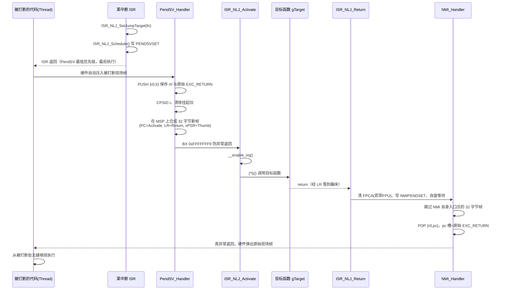

# ISR_NLJ — 在 ISR 返回时实现非局部跳转

ISR_NLJ 是一个约 300 行、零依赖（仅需 CMSIS）的 Cortex-M 底层组件。它解决这样一个需求：

> **在任意中断服务程序里"挂号"一个函数；CPU 处理完所有中断、即将返回被打断的代码时，先不回去——而是让这个函数"插队"到断点上执行；它执行完毕后，被打断的代码才从断点处无缝继续。**
>
> 被打断的代码就像被按了暂停键：现场（寄存器、栈、执行点）原样冻结，等插队的函数跑完再自动解冻，从暂停的那条指令继续，前后毫不知情。

这就是"非局部跳转（Non-Local Jump）"——跳转目标不在当前调用链上，而跳转完成后还能回到原点。整个机制不依赖任何 RTOS，不额外创建任务、不占用额外线程栈。

---

## 使用特色

- **事后异步执行**：跳转目标经由 PendSV（最低优先级）触发——ISR 里只是"挂号"，函数本体要等该 ISR 及所有更高优先级中断处理完之后才插队执行，不阻塞任何中断，天然与中断系统"排队让行"。
- **原始现场无损恢复**：目标函数执行完毕后，通过 NMI 恢复被打断代码的完整现场（寄存器、栈、执行点全部还原），跳转对被打断代码完全透明。
- **零任务、零额外栈**：目标函数直接在主栈（MSP）上运行，使用当前栈空间向下生长，无需为"延迟任务"分配独立栈——这是与 RTOS `deferred task` 方案的本质区别。
- **不可屏蔽的收尾保障**：恢复动作借道 NMI 完成，即使全局中断被关闭（PRIMASK=1）也能立即触发，杜绝恢复环节被卡死的可能。
- **支持嵌套调度**：目标函数运行于线程上下文、中断保持开启，期间的新中断可以再次调度一次非局部跳转，多层嵌套的栈配对依然自洽。
- **多编译器适配**：同一份源码覆盖 GCC / Clang、Keil AC6（`__attribute__((naked))`）、Keil AC5（`__asm void` 嵌入式汇编分支）、IAR（`__naked`/`__root` 关键字分支）。
- **极小 footprint**：单 `.c` 单 `.h`，无静态分配 buffer，无初始化开销（一次 NVIC 优先级设置）。

## 实现原理

机制由四个主角协作完成：**PendSV（合成跳转）→ 激活函数（执行目标）→ 返回蹦床（挂起 NMI）→ NMI（恢复现场）**。



### 栈的旅程（关键在字节级精确配对）

```text
MSP（高地址 → 低地址）
┌──────────────────────────────┐
│  被打断代码的现场帧            │ ← 硬件在 PendSV 入口压入
│  r0 r1 r2 r3 r12 lr pc xPSR  │    （真实现场，等待最终恢复）
├──────────────────────────────┤
│  r0  保存值                   │ ← PendSV_Handler: PUSH {r0,lr}
│  原始 EXC_RETURN              │    NMI_Handler: POP {r0,pc} 恢复
├──────────────────────────────┤
│  合成的 8 字基本异常帧          │ ← PendSV_Handler 手工合成
│  r0  r1  r2  r3  r12 (垃圾值) │    其余槽为垃圾值即可——
│  LR  = ISR_NLJ_Return         │    真实寄存器已在上方现场帧里
│  PC  = ISR_NLJ_Activate       │    伪异常返回的"返回地址"
│  xPSR = 0x01000000            │    bit24 Thumb=1
└──────────────────────────────┘
        ↓ 目标函数使用此栈向下生长
```

分步说明：

1. **调度**：ISR 中调用 `ISR_NLJ_Schedule()`，向 ICSR 写 PENDSVSET。PendSV 已被 `ISR_NLJ_Init()` 配为最低优先级，因此它一定在该 ISR（及所有挂起的高优先级中断）返回之后才触发。
2. **合成栈帧**：`PendSV_Handler` 是裸函数（无编译器 prologue/epilogue）。它先 `PUSH {r0,lr}` 把 r0 和**原始 EXC_RETURN**（NMI 恢复现场的关键凭证）压栈，随后 `CPSID i` 关全局中断保证过程原子，清除 PendSV 挂起位防止重复触发，再在 MSP 上预留 32 字节并填入三个关键字槽（LR、PC、xPSR），最后 `BX 0xFFFFFFF9` 触发一次"伪异常返回"——硬件弹出合成帧，把 PC 装载为 `ISR_NLJ_Activate`、LR 装载为 `ISR_NLJ_Return`，"返回"进了一个从未被调用过的函数。
3. **激活**：`ISR_NLJ_Activate` 把 `volatile` 的 `gTarget` 快照到局部变量（保证执行期间一致性），`__enable_irq()` 重开中断，然后调用目标函数。此时处于线程上下文（IPSR=0）、使用 MSP，中断完全保持响应。
4. **返回蹦床**：目标函数 `return` 时经 LR 落到 `ISR_NLJ_Return`。若带硬件 FPU 编译，先清除 `CONTROL.FPCA` 位，确保 NMI 入口只压 8 字基本帧；随后向 ICSR 写 NMIPENDSET 挂起 NMI，原地自旋等待。
5. **恢复现场**：NMI 不可被任何手段屏蔽，立即抢占自旋。`NMI_Handler`（同为裸函数）直接 `ADD sp,#32` 跳过 NMI 入口自动压栈的帧，`CPSIE i` 恢复中断使能，然后 `POP {r0,pc}`——pc 槽里正是第 2 步保存的**原始 EXC_RETURN**。向 PC 写入 EXC_RETURN 触发一次真正的异常返回，硬件从最初被打断的位置弹出真实现场帧，被打断的代码无缝继续。

整个机制只"借用"了两级异常（PendSV 与 NMI）的硬件压栈/出栈行为，通过字节级精确的栈操作让它们携带私货，实现一次进、一次出、收支平衡的跳转与回环。

## 使用方法

### 1. 集成

把 `Inc/isr_nlj.h`、`Src/isr_nlj.c` 加入工程，include 路径加入 `Inc`。模块依赖 CMSIS 设备头（示例中为 `stm32h5xx.h`），移植到其他 Cortex-M 芯片时替换该包含即可。

> **重要**：CubeMX 生成的 `stm32h5xx_it.c` 中带有**非 weak** 的 `NMI_Handler` 与 `PendSV_Handler`，加入 `isr_nlj.c` 前必须先删除它们，否则链接时重复定义（`_example` 示例工程中已删除，CubeMX 重新生成代码时需再次删除）。

### 2. API

| API | 说明 |
| --- | --- |
| `void ISR_NLJ_Init(void)` | 初始化：将 PendSV 设为最低优先级。启动时调用一次。 |
| `void ISR_NLJ_SetJumpTarget(void(*target)(void))` | 设置跳转目标函数。目标函数要求 `void f(void)` 形式。 |
| `void ISR_NLJ_Schedule(void)` | 写 PENDSVSET，调度一次非局部跳转。通常在 ISR 中调用。 |

### 3. 示例（来自 `_example`：按键触发三色轮转）

```c
#include "isr_nlj.h"

static void NLJ_Target0(void) { BSP_LED_Toggle(LED1); printf("NLJ_Target0\n"); }
static void NLJ_Target1(void) { BSP_LED_Toggle(LED2); printf("NLJ_Target1\n"); }
static void NLJ_Target2(void) { BSP_LED_Toggle(LED3); printf("NLJ_Target2\n"); }

int main(void)
{
    /* ...HAL/时钟/外设初始化... */
    ISR_NLJ_Init();          /* 一次性初始化 */
    while (1) { /* 主循环每 500ms 打印 tick，不受跳转影响 */ }
}

/* 按键中断回调（BSP_PB_Callback 由 EXTI ISR 调用） */
void BSP_PB_Callback(Button_TypeDef Button)
{
    static uint32_t counter = 0;
    if (Button == BUTTON_USER) {
        ISR_NLJ_SetJumpTarget(counter % 3 == 0 ? NLJ_Target0
                             : counter % 3 == 1 ? NLJ_Target1
                             :                    NLJ_Target2);
        ISR_NLJ_Schedule();  /* ISR 返回后执行目标，执行完恢复主循环 */
        counter++;
    }
}
```

效果：每次按键，ISR 返回后（而非 ISR 内部）执行 LED 翻转与打印，完成后主循环从被打断处继续，`tick` 打印节奏不受影响。

### 4. 约束与注意事项

- **NMI 被本模块独占**：任何真实 NMI 源（如时钟安全系统 CSS、RAMECC 纠错）触发都会落入恢复逻辑而崩溃。启用这些 NMI 源的系统请勿使用本模块。
- **PendSV 被本模块独占**：与 FreeRTOS 等 RTOS 的 PendSV 调度器互斥，本模块面向裸机/前后台系统。
- **保持 PendSV 最低优先级**：不要在初始化之后再改写其优先级。
- **硬件 FPU 的浮点上下文**：若以硬 FPU 编译，且"被打断的代码"与"目标函数"都使用浮点，lazy stacking 的交互可能导致被打断上下文的 s0–s15 被目标函数改写。稳妥做法是软浮点编译，或在 `ISR_NLJ_Init` 中清除 `FPCCR.LSPEN` 关闭 lazy stacking。
- **编译器支持**：GCC/Clang 与 Keil AC6 原生支持；Keil AC5 走文件末尾的 `__asm void` 分支；IAR 分支按 `__naked`/`__root` 关键字编写，请在实际使用的 IAR 版本上验证——若该版本不支持 `__naked`，可将三个裸函数改为独立汇编源文件实现（指令序列完全相同）。
- **目标函数的运行环境**：线程上下文、MSP、中断开启。它可以使用局部变量、调用库函数，但请避免永不返回（`while(1)` 会让恢复永远不会发生）；栈深消耗大时注意 MSP 余量。

## 目录结构

```text
ISR_NLJ/
├── Inc/isr_nlj.h        对外 API
├── Src/isr_nlj.c        实现（含四编译器适配层）
└── _example/            STM32H563 Nucleo 演示工程（IAR EWARM）
    └── Core/Src/main.c  按键触发三色 LED 轮转示例
```

## License

见仓库根目录 [LICENSE](LICENSE)。
# ISR_NLJ
